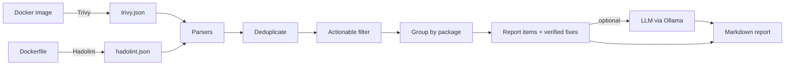

# DockerDecode

**Turn hundreds of container scanner alerts into a short, ordered fix list, explained in plain English by a local LLM.**


-black)

DockerDecode runs deterministic security scanners on a Docker image and its Dockerfile, merges and triages the results into a remediation plan, and asks an LLM to explain each item. The scanners decide **what** is wrong and **which version** fixes it. The LLM only explains. Versions, CVE IDs and fixes in the report always come from the scanners, never from the model.

---

## Why

Scanning a single container image typically produces hundreds of findings. Most of them are duplicates, have no fix yet, or sit in packages the application never runs. Developers learn to ignore the wall of alerts, and the real problems get lost in it.

DockerDecode attacks this alert fatigue in two layers:

1. **Deterministic triage**: merge duplicates, separate fixable from unfixable, and group CVEs into one upgrade per package.
2. **AI explanation**: for the handful of items left, explain the risk and the fix in language a developer can act on.

## Results on the test image

The repository includes a deliberately vulnerable image (`test-target/Dockerfile`) and a hardened version (`test-target/Dockerfile.hardened`).

**Triage on the vulnerable image:**

```
646 raw findings  ->  280 after merging duplicates  ->  1 secret + 10 upgrades + 1 Dockerfile issue
```

**Hardening the image, measured with Trivy:**

| | Vulnerable | Hardened |
|---|---|---|
| Fixable vulnerabilities | 305 | **0** |
| CRITICAL | 4 | **0** |
| Total findings | 639 | 165 (−74%) |
| Image size | 278 MB | less than half |
| Runs as root | yes | no (UID 10001) |
| Secret baked into image | yes | no |

The 165 remaining findings all have no upstream fix yet. The goal is **zero fixable HIGH/CRITICAL issues**, not zero findings.

---

## How it works



| Stage | Module | What it does |
|---|---|---|
| Parse | `scanner/parsers.py` | Converts Trivy and Hadolint JSON into one common `Finding` model |
| Deduplicate | `scanner/triage.py` | One CVE in `libssl3t64` and `openssl` becomes one finding with both packages listed |
| Filter | `scanner/triage.py` | Keeps secrets, fixable vulnerabilities and lint issues at or above a severity threshold |
| Group | `scanner/triage.py` | One upgrade per package: "OpenSSL → 3.5.7 fixes 11 CVEs" |
| Versions | `scanner/versions.py` | Ecosystem-aware version comparison (PEP 440 for Python, dpkg rules for Debian) |
| Explain | `scanner/explain.py`, `scanner/llm.py` | Sends each item's facts to the LLM with a JSON schema, validates the answer |
| Report | `scanner/report.py` | Renders Markdown for the terminal, GitHub, or a PR comment |

---

## Design principles

**Scanners are the source of truth.** The LLM receives a fixed set of facts per item and is told to use only those. The report's "Verified fix" line is computed by the tool, not written by the model. A test feeds a model that invents a wrong version and checks the report still shows the correct one.

**Triage before AI.** The LLM sees about 12 items instead of 646 findings. That keeps it fast, cheap and focused, and the tool is still useful with the AI layer turned off.

**Developers fix packages, not CVEs.** Findings are grouped by source package and resolved to a single target version that fixes every CVE in the group.

**Never recommend a downgrade.** An invariant test checks that every recommended version is newer than the installed one, on hand-made fixtures and on real scan output.

**Fail soft.** If the LLM is unreachable or returns bad output, the report is still produced with every verified fix. One failure never hides the scanner results.

**Provider-agnostic.** The LLM sits behind a one-method interface (`generate_json`). Ollama is implemented; Gemini, Claude or OpenAI need one new class each.

**Local and private by default.** Ollama runs on your machine. No API key, no cost, and scan data never leaves your computer.

---

## Quick start

### Prerequisites

- Docker
- Python 3.12+
- About 3 GB of disk space for the default LLM (only if you use `--explain`)

### 1. Install

```bash
git clone https://github.com/<your-username>/DockerDecode.git
cd DockerDecode
python -m venv .venv
source .venv/bin/activate          # Windows: .venv\Scripts\activate
pip install -r requirements-dev.txt
python -m pytest
```

### 2. Build the test images

```bash
docker build -t vuln-test ./test-target
docker build -f test-target/Dockerfile.hardened -t vuln-test:hardened ./test-target
```

### 3. Scan

Both scanners run as containers, so nothing else needs installing.

```bash
mkdir -p reports

# Trivy: vulnerabilities and secrets in the image
docker run --rm \
  -v /var/run/docker.sock:/var/run/docker.sock \
  -v trivy-cache:/root/.cache/ \
  -v "$PWD/reports:/out" \
  aquasec/trivy image --list-all-pkgs \
  --scanners vuln,secret --image-config-scanners misconfig,secret \
  --format json -o /out/trivy.json vuln-test

# Hadolint: Dockerfile best practices
docker run --rm -v "$PWD/test-target:/src" hadolint/hadolint \
  hadolint --format json /src/Dockerfile > reports/hadolint.json
```

<details>
<summary>Windows PowerShell</summary>

Replace `\` line
